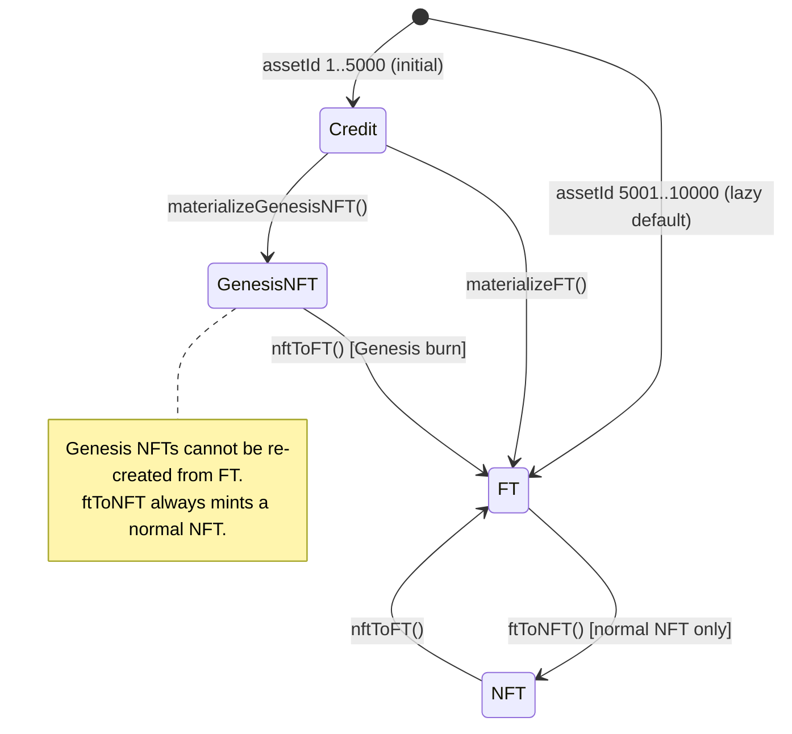

English | [中文](./architecture.zh.md)

# Architecture

## 1. Problem and mechanism

| Problem | Flux mechanism | Where it lives |
|---|---|---|
| An NFT is illiquid, an ERC-20 loses per-unit identity | One Asset Unit can switch between an NFT and 10,000 FLUX | `ConversionEngine` + `AssetRegistry` |
| A launch needs price discovery without an order book | Continuous uniform-price CCA with budget + max price bids | `GenesisAuction`, `CCAAllocator` |
| Genesis supporters deserve a durable share | Genesis NFTs stay in `GenesisVault` and earn pro-rata rewards | `GenesisVault`, `RewardVault` |
| Rewards should not be pushed to contracts that reject them | Pull-based claims into ERC-6551 accounts, swept on burn | `AccountManager`, `FluxAccount` |
| A fixed-supply asset needs a liquidity venue | Genesis proceeds bootstrap FLUX/ETH; a minimal AMM is included | `LiquidityVault`, `integration/flux-amm/*` |
| Fees must respond to the NFT/FT balance | Dynamic fee/reward curve around a target FT ratio | `BalanceEngine`, `FeeCurve` |

## 2. Layers

```text
┌──────────────────────────────────────────────────────────────────────┐
│ Genesis (launch)                                                     │
│ GenesisAuction ── CCAAllocator                                       │
│      │ credits, FLUX, ETH                                            │
└──────┼───────────────────────────────────────────────────────────────┘
       ▼
┌──────────────────────────────────────────────────────────────────────┐
│ Core (state machine)                                                 │
│ AssetRegistry ◄── ConversionEngine ──► FluxToken                     │
│                         │  └──────────► DynamicNFT ──► trait/*       │
│                         │                                            │
│                         ├──► BalanceEngine (fee/reward quote)        │
│                         ├──► AccountManager ──► ERC6551Registry      │
│                         └──► GenesisVault ──► RewardVault            │
└──────────────────────────────────────────────────────────────────────┘
       │ fees                                  │ rewards
       ▼                                       ▼
┌──────────────────────────────┐   ┌───────────────────────────────────┐
│ FeeEngine                    │   │ RewardAssetRegistry               │
│ ├─ LiquidityVault            │   │ RewardVault (liabilities)         │
│ ├─ RewardStrategyManager     │   │ GenesisVault (pro-rata rewards)   │
│ ├─ BalanceVault              │   │ RewardStrategyManager ── strategy │
│ └─ ProtocolVault             │   └───────────────────────────────────┘
└──────────────────────────────┘
       │
       ▼
┌──────────────────────────────────────────────────────────────────────┐
│ Integrations                                                         │
│ Chainlink VRF / Sync VRF · Uniswap V2 liquidity · Uniswap V4 migrator│
│ FluxAMMFactory → FluxNativePair ◄── FluxSwapRouter                   │
└──────────────────────────────────────────────────────────────────────┘
```

## 3. Asset state model



`AssetRegistry` only writes state when an Asset transitions. For untouched ids `_stateOf()` derives
`Credit` or `FT` from `initialCreditUnits`. `transition()` is restricted to `CONTROLLER_ROLE`
(`ConversionEngine`).

## 4. Supply invariants

1. `stateCount[Credit] + stateCount[GenesisNFT] + stateCount[NFT] + stateCount[FT] == 10,000`.
2. `flux.totalSupply == ftUnits * 10,000e18`.
3. A Genesis right destroyed by `nftToFT` can never be re-created by `ftToNFT`.
4. `RewardVault` balance for an asset is always at least its recorded liability.
5. Genesis burn settles rewards and TBA assets before the NFT is burned.

These are enforced by `test/invariant/ProtocolInvariant.t.sol`.

## 5. Deployment topology

There is one shared deployment per chain:

| Component | Cardinality | Notes |
|---|---|---|
| `AssetRegistry`, `CreditManager`, `FluxToken`, `DynamicNFT` | one each | Shared core |
| `TraitStorage`, `TraitGenerator`, `TraitRenderer`, three renderers | one each | Renderer addresses are immutable in `DynamicNFT` |
| `ERC6551Registry`, `AccountManager` | one each | Account implementation is set once |
| `RewardAssetRegistry`, `RewardVault`, `GenesisVault`, `RewardStrategyManager` | one each | Reward stack |
| `BalanceEngine`, `BalanceVault`, `LiquidityVault`, `ProtocolVault`, `FeeEngine` | one each | Fee/reward stack |
| `GenesisAuction`, `CCAAllocator` (library) | one each | Auction lifecycle |
| `UniswapV2LiquidityAdapter` or `MockLiquidityAdapter` | one | Chosen from env |
| `FluxAMMFactory`, `FluxSwapRouter`, `MockUniswapV2Migrator` | one each | Demo/AMM venue |

`Deploy.s.sol` wires roles in dependency order and optionally transfers `DEFAULT_ADMIN_ROLE` to
`PROTOCOL_ADMIN`, revoking the deployer.

## 6. Upgrade and emergency model

- **No proxy.** Contracts are immutable; a defect requires a migration.
- `ConversionEngine` has `PAUSER_ROLE` and can pause conversions, minting and burning.
- `RewardStrategyManager` has its own pause controlled by `DEFAULT_ADMIN_ROLE`.
- `AccessControl` admin roles should be held by a multisig or timelock on production deployments.

See [security.md](./security.md) for the full role matrix and [flows.md](./flows.md) for call
sequences.

Chinese version: [architecture.zh.md](./architecture.zh.md).
