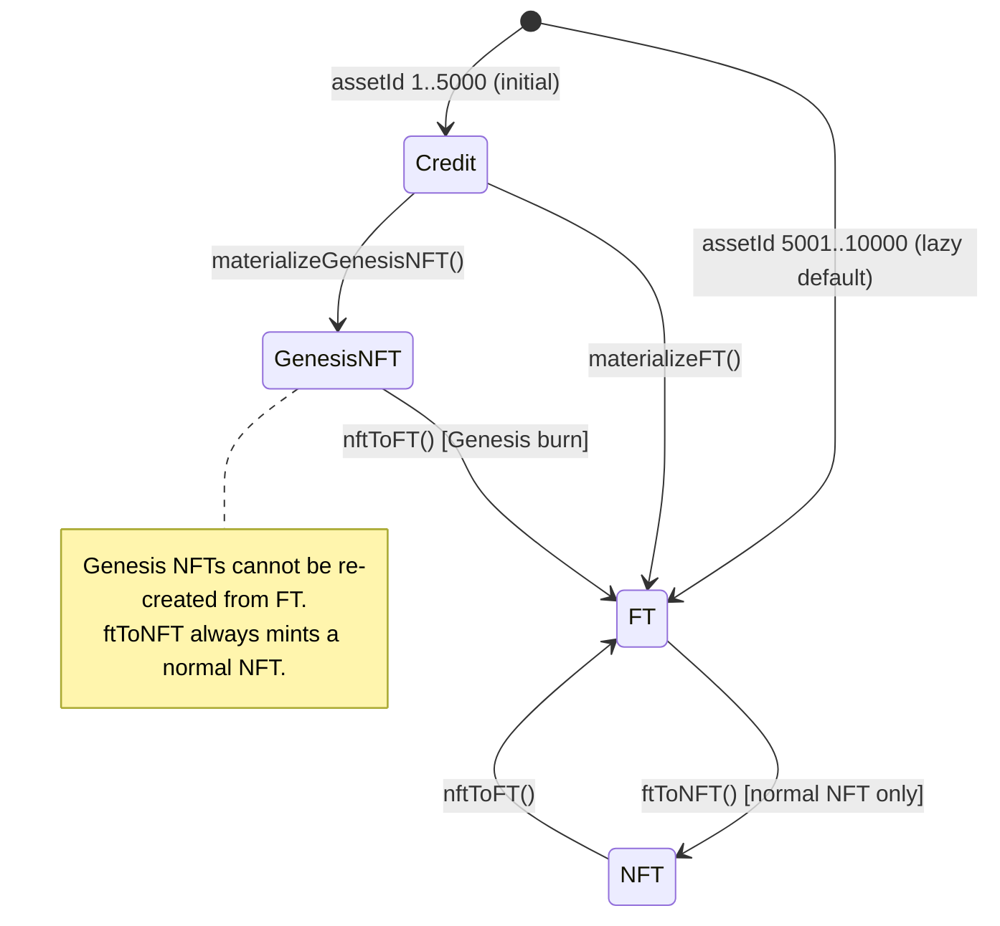

[English](./architecture.md) | 中文

# 架构

## 1. 问题与机制

| 问题 | Flux 机制 | 所在位置 |
|---|---|---|
| NFT 缺乏流动性，ERC-20 则失去逐单元的身份标识 | 一个资产单元可以在 NFT 与 10,000 FLUX 之间切换 | `ConversionEngine` + `AssetRegistry` |
| 发行需要价格发现，但不依赖订单簿 | 带预算与最高价出价的连续统一价格 CCA | `GenesisAuction`、`CCAAllocator` |
| Genesis 支持者应获得持久份额 | Genesis NFT 留在 `GenesisVault` 中并按比例获得奖励 | `GenesisVault`、`RewardVault` |
| 奖励不应被推送到会拒绝接收的合约 | 拉取式领取到 ERC-6551 账户，销毁时划转 | `AccountManager`、`FluxAccount` |
| 固定供应量资产需要流动性场所 | Genesis 所得用于引导 FLUX/ETH 流动性；内置一个最小化 AMM | `LiquidityVault`、`integration/flux-amm/*` |
| 费用必须随 NFT/FT 平衡状况调整 | 围绕目标 FT 比例的动态费用/奖励曲线 | `BalanceEngine`、`FeeCurve` |

## 2. 分层

```text
┌──────────────────────────────────────────────────────────────────────┐
│ Genesis (launch)                                                     │
│ GenesisAuction ── CCAAllocator                                       │
│      │ credits, FLUX, ETH                                            │
└──────┼───────────────────────────────────────────────────────────────┘
       ▼
┌──────────────────────────────────────────────────────────────────────┐
│ Core (state machine)                                                 │
│ AssetRegistry ◄── ConversionEngine ──► FluxToken                     │
│                         │  └──────────► DynamicNFT ──► trait/*       │
│                         │                                            │
│                         ├──► BalanceEngine (fee/reward quote)        │
│                         ├──► AccountManager ──► ERC6551Registry      │
│                         └──► GenesisVault ──► RewardVault            │
└──────────────────────────────────────────────────────────────────────┘
       │ fees                                  │ rewards
       ▼                                       ▼
┌──────────────────────────────┐   ┌───────────────────────────────────┐
│ FeeEngine                    │   │ RewardAssetRegistry               │
│ ├─ LiquidityVault            │   │ RewardVault (liabilities)         │
│ ├─ RewardStrategyManager     │   │ GenesisVault (pro-rata rewards)   │
│ ├─ BalanceVault              │   │ RewardStrategyManager ── strategy │
│ └─ ProtocolVault             │   └───────────────────────────────────┘
└──────────────────────────────┘
       │
       ▼
┌──────────────────────────────────────────────────────────────────────┐
│ Integrations                                                         │
│ Chainlink VRF / Sync VRF · Uniswap V2 liquidity · Uniswap V4 migrator│
│ FluxAMMFactory → FluxNativePair ◄── FluxSwapRouter                   │
└──────────────────────────────────────────────────────────────────────┘
```

## 3. 资产状态模型



`AssetRegistry` 仅在资产发生转换时写入状态。对于未触碰的 id，`_stateOf()` 根据 `initialCreditUnits` 推导出 `Credit` 或 `FT`。`transition()` 仅限 `CONTROLLER_ROLE`（`ConversionEngine`）调用。

## 4. 供应量不变量

1. `stateCount[Credit] + stateCount[GenesisNFT] + stateCount[NFT] + stateCount[FT] == 10,000`。
2. `flux.totalSupply == ftUnits * 10,000e18`。
3. 被 `nftToFT` 销毁的 Genesis 权益永远无法通过 `ftToNFT` 重新创建。
4. 某个资产的 `RewardVault` 余额始终至少等于其记录的负债。
5. Genesis 销毁时，先结算奖励和 TBA 资产，再销毁 NFT。

这些不变量由 `test/invariant/ProtocolInvariant.t.sol` 强制执行。

## 5. 部署拓扑

每条链上有一份共享部署：

| 组件 | 数量 | 说明 |
|---|---|---|
| `AssetRegistry`、`CreditManager`、`FluxToken`、`DynamicNFT` | 各一个 | 共享核心 |
| `TraitStorage`、`TraitGenerator`、`TraitRenderer`、三个渲染器 | 各一个 | 渲染器地址在 `DynamicNFT` 中不可变 |
| `ERC6551Registry`、`AccountManager` | 各一个 | 账户实现只设置一次 |
| `RewardAssetRegistry`、`RewardVault`、`GenesisVault`、`RewardStrategyManager` | 各一个 | 奖励栈 |
| `BalanceEngine`、`BalanceVault`、`LiquidityVault`、`ProtocolVault`、`FeeEngine` | 各一个 | 费用/奖励栈 |
| `GenesisAuction`、`CCAAllocator`（库） | 各一个 | 拍卖生命周期 |
| `UniswapV2LiquidityAdapter` 或 `MockLiquidityAdapter` | 一个 | 由环境变量选择 |
| `FluxAMMFactory`、`FluxSwapRouter`、`MockUniswapV2Migrator` | 各一个 | 演示/AMM 场所 |

`Deploy.s.sol` 按依赖顺序配置角色，并可选择将 `DEFAULT_ADMIN_ROLE` 转给 `PROTOCOL_ADMIN`，同时撤销部署者的管理员角色。

## 6. 升级与应急模型

- **无代理。** 合约为不可变合约；修复缺陷需要迁移。
- `ConversionEngine` 具有 `PAUSER_ROLE`，可暂停转换、铸造和销毁。
- `RewardStrategyManager` 拥有自己的暂停开关，由 `DEFAULT_ADMIN_ROLE` 控制。
- 生产部署中，`AccessControl` 管理员角色应由多签或时间锁持有。

有关完整的角色矩阵，请参阅 [security.zh.md](./security.zh.md)；有关调用顺序，请参阅 [flows.zh.md](./flows.zh.md)。

英文版本：[architecture.md](./architecture.md)。
