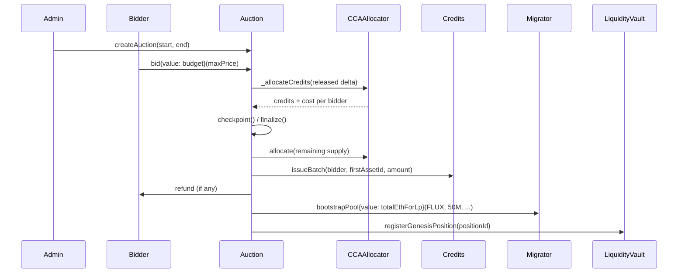
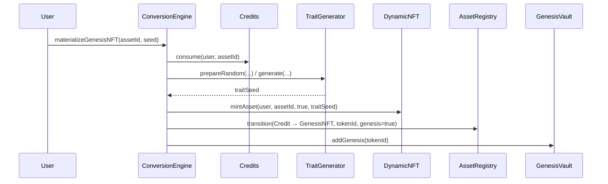
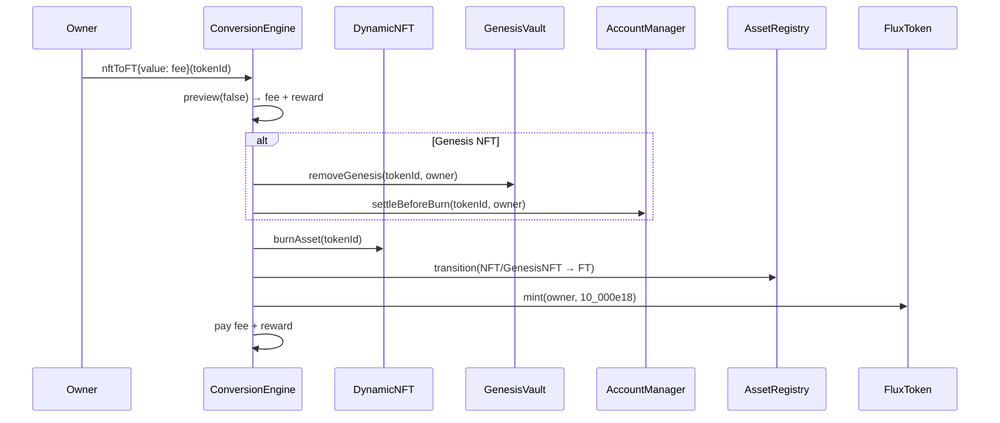

English | [中文](./flows.zh.md)

# Core Flows

Flows are written in execution order. Addresses in diagrams are illustrative; the deployed wiring is
created by `script/Deploy.s.sol`.

## 0. Deployment

```text
deployer
  ├─ AssetRegistry(admin) + initializeGenesis(5_000)
  ├─ CreditManager(admin), FluxToken(admin)
  ├─ TraitStorage → TraitGenerator(randomProvider)
  ├─ Frog renderers → TraitRenderer → DynamicNFT(renderer)
  ├─ RewardAssetRegistry → RewardVault → GenesisVault
  ├─ ERC6551Registry → FluxAccount implementation → AccountManager
  ├─ BalanceEngine, BalanceVault, LiquidityVault, ProtocolVault
  ├─ RewardStrategyManager → FeeEngine
  ├─ ConversionEngine (wired to all of the above)
  ├─ GenesisAuction (credits, FLUX, migrator, LiquidityVault)
  └─ FluxAMMFactory → FluxSwapRouter, liquidity migrator/adapter
```

Roles are granted bottom-up: conversion is the controller of the registry and Genesis vault, the
auction can issue credits and mint FLUX, the fee engine can execute the reward strategy, and the
deployer transfers `DEFAULT_ADMIN_ROLE` to `PROTOCOL_ADMIN` when configured.

## 1. Genesis auction



1. `createAuction` requires `start >= now` and `end > start`; Credits are released linearly.
2. `bid` escrows ETH, records `budget` and `maxPrice`, and checkpoints the released tranche.
3. `cancelBid` is allowed only before the end and before any allocation; the full budget is refunded.
4. `finalize` allocates the remaining supply, reverts with `AuctionUndersubscribed` if demand is
   insufficient, mints 50,000,000 FLUX, bootstraps liquidity and locks the position.
5. `claimCreditBatch` mints Credits in batches of at most `maxCredits`; the final batch also pays the
   bidder's refund and marks the bid settled.

Clearing price and allocation are computed by `CCAAllocator`: the highest price at which demand
covers the tranche, then pro-rata allocation with deterministic remainder distribution.

## 2. Credit → Genesis NFT



The user becomes the owner of a Genesis NFT. The NFT accrues rewards from the current
`accRewardPerGenesis` baseline and can own an ERC-6551 account.

## 3. Credit → FT

`materializeFT(assetId)` consumes the Credit, transitions `Credit → FT`, queues the asset for future
FT→NFT minting and mints `10,000e18` FLUX to the caller. No fee is charged at materialization.

## 4. NFT → FT



`nftToFT` requires the exact quoted fee. For a Genesis NFT, rewards are claimed into the TBA and all
enabled registered assets are swept to the owner before the NFT is burned. The Genesis right is
permanently destroyed.

## 5. FT → NFT

`ftToNFT(seed)` burns 10,000 FLUX, takes an asset from the FT queue (or lazily from the untouched FT
range), generates new traits and mints a normal NFT. A Genesis NFT can never be re-created this way.
The quoted fee is paid in the same call.

## 6. Dynamic fee and reward

`BalanceEngine.quote(ftUnits, nftUnits, vaultBalance, ftToNft)` computes the FT ratio and returns:

- **Fee** — if FT→NFT and the FT share is below `lowerBps`, or NFT→FT and the FT share is above
  `upperBps`; scaled linearly up to `maxFee`.
- **Reward** — the opposite direction; a share of the `BalanceVault` daily budget scaled by the
  distance from the target range.

Default parameters: `lowerBps = 3000`, `upperBps = 4000`, `maxFee = 0.01 ether`,
`rewardQuoteBps = 100`.

## 7. Fee distribution

`FeeEngine.distribute()` splits its ETH balance by `feeSplit`:

```text
30% → LiquidityVault   (compounded by LP_MANAGER_ROLE; Genesis position is locked)
25% → RewardStrategyManager → selected strategy → RewardVault → GenesisVault
25% → BalanceVault     (daily conversion-reward budget)
20% → ProtocolVault    (withdrawn by the protocol recipient)
```

`RewardStrategyManager.holdNative` deposits ETH directly; `execute` runs a registered strategy,
checks `minAmountOut` and deposits the output asset.

## 8. Genesis rewards and burn

- Rewards are deposited per asset into `RewardVault` and accrued in `GenesisVault`.
- `claim(tokenId, asset)` or `claimAllRegistered(tokenId)` pays the pending amount to the NFT's TBA.
- On `nftToFT`, `GenesisVault.removeGenesis` first deactivates the Genesis, then claims all pending
  rewards to the TBA; `AccountManager.settleBeforeBurn` sweeps every enabled asset to the owner.
- The NFT is burned after settlement, so no reward can be claimed twice.

## 9. Flux AMM

`MockUniswapV2Migrator` creates a `FluxNativePair` and seeds it. Users trade through
`FluxSwapRouter`:

- `swapExactETHForTokens` takes the protocol fee from `msg.value`, forwards net ETH to the pair and
  sends tokens to the recipient.
- `swapExactTokensForETH` pulls tokens, swaps to gross ETH, takes the protocol fee and forwards net
  ETH.
- `getAmountOutETHForToken` and `getAmountOutTokenForETH` mirror the pair math exactly, including the
  0.3% pool fee and the protocol fee.

## 10. Pause and recovery

`ConversionEngine.setPaused(true)` blocks materialization and conversion but does not block auction
claims, rewards, fee distribution or liquidity operations. `RewardStrategyManager.setPaused(true)`
blocks strategy execution. Unpausing requires the corresponding role. There is no upgrade path.

Chinese version: [flows.zh.md](./flows.zh.md).
