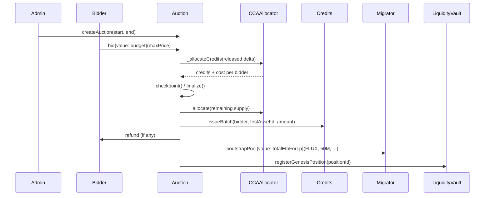
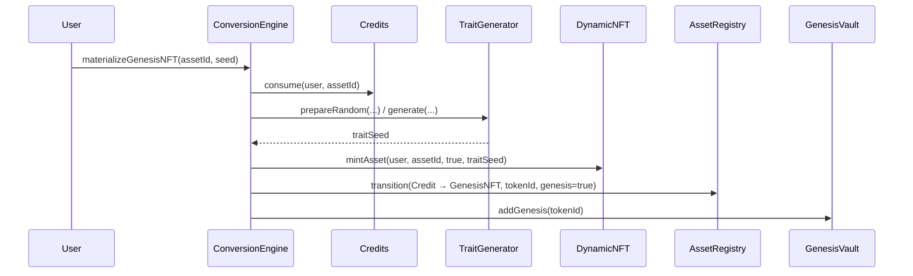
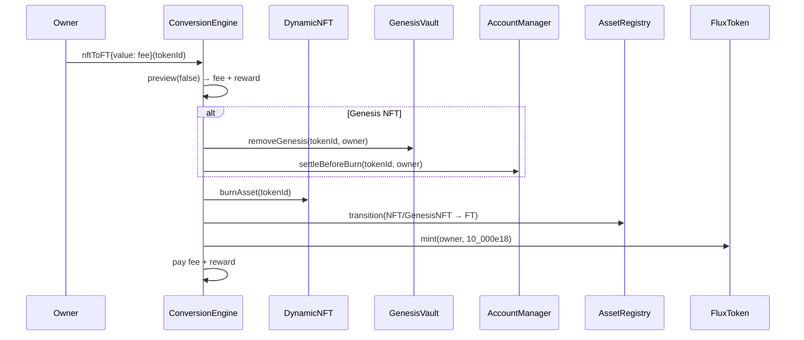

[English](./flows.md) | 中文

# 核心流程

各流程按执行顺序编写。图中的地址仅作示意；实际部署中的合约连接关系由 `script/Deploy.s.sol` 创建。

## 0. 部署

```text
deployer
  ├─ AssetRegistry(admin) + initializeGenesis(5_000)
  ├─ CreditManager(admin), FluxToken(admin)
  ├─ TraitStorage → TraitGenerator(randomProvider)
  ├─ Frog renderers → TraitRenderer → DynamicNFT(renderer)
  ├─ RewardAssetRegistry → RewardVault → GenesisVault
  ├─ ERC6551Registry → FluxAccount implementation → AccountManager
  ├─ BalanceEngine, BalanceVault, LiquidityVault, ProtocolVault
  ├─ RewardStrategyManager → FeeEngine
  ├─ ConversionEngine (wired to all of the above)
  ├─ GenesisAuction (credits, FLUX, migrator, LiquidityVault)
  └─ FluxAMMFactory → FluxSwapRouter, liquidity migrator/adapter
```

角色按自底向上的顺序授予：转换引擎是注册表和 Genesis 金库的控制器，拍卖可以发行 Credit 并铸造 FLUX，费用引擎可以执行奖励策略；配置了 `PROTOCOL_ADMIN` 时，部署者会将 `DEFAULT_ADMIN_ROLE` 转交给它。

## 1. Genesis 拍卖



1. `createAuction` 要求 `start >= now` 且 `end > start`；Credit 线性释放。
2. `bid` 托管 ETH，记录 `budget` 和 `maxPrice`，并对已释放批次设置检查点。
3. `cancelBid` 仅允许在拍卖结束前且尚未发生任何分配时调用；全额预算将退还。
4. `finalize` 分配剩余供应量；若需求不足，会以 `AuctionUndersubscribed` 回滚；随后铸造 50,000,000 FLUX、引导流动性并锁定头寸。
5. `claimCreditBatch` 以每次最多 `maxCredits` 的数量分批铸造 Credit；最后一批还会支付竞标者的退款，并将该出价标记为已结算。

出清价格与分配由 `CCAAllocator` 计算：先找出需求足以覆盖该批次的最高价格，再按比例分配，并以确定性的方式分配余数。

## 2. Credit → Genesis NFT



用户成为 Genesis NFT 的所有者。该 NFT 从当前的 `accRewardPerGenesis` 基线开始累积奖励，并且可以拥有一个 ERC-6551 账户。

## 3. Credit → FT

`materializeFT(assetId)` 会消费 Credit，将状态从 `Credit` 转换为 `FT`，把该资产加入队列以供后续 FT→NFT 铸造，并向调用者铸造 `10,000e18` FLUX。具现化时不收取费用。

## 4. NFT → FT



`nftToFT` 要求支付与报价完全一致的费用。对于 Genesis NFT，奖励会先领取到 TBA，所有已启用的注册资产会在 NFT 销毁前划转给所有者。Genesis 权益将被永久销毁。

## 5. FT → NFT

`ftToNFT(seed)` 销毁 10,000 FLUX，从 FT 队列中取出一个资产（或从尚未触碰的 FT 区间惰性获取），生成新的 trait 并铸造一个普通 NFT。Genesis NFT 永远无法通过这种方式重新创建。报价费用在同一调用中支付。

## 6. 动态费用与奖励

`BalanceEngine.quote(ftUnits, nftUnits, vaultBalance, ftToNft)` 计算 FT 比例并返回：

- **费用** — 当 FT→NFT 且 FT 占比低于 `lowerBps`，或 NFT→FT 且 FT 占比高于 `upperBps` 时收取；按线性比例缩放，最高到 `maxFee`。
- **奖励** — 在相反方向发放；金额为 `BalanceVault` 每日预算的一部分，按与目标区间的距离缩放。

默认参数：`lowerBps = 3000`、`upperBps = 4000`、`maxFee = 0.01 ether`、`rewardQuoteBps = 100`。

## 7. 费用分配

`FeeEngine.distribute()` 按 `feeSplit` 拆分其 ETH 余额：

```text
30% → LiquidityVault   (compounded by LP_MANAGER_ROLE; Genesis position is locked)
25% → RewardStrategyManager → selected strategy → RewardVault → GenesisVault
25% → BalanceVault     (daily conversion-reward budget)
20% → ProtocolVault    (withdrawn by the protocol recipient)
```

`RewardStrategyManager.holdNative` 直接存入 ETH；`execute` 运行已注册策略，检查 `minAmountOut` 并存入产出资产。

## 8. Genesis 奖励与销毁

- 奖励按资产存入 `RewardVault`，并在 `GenesisVault` 中累积。
- `claim(tokenId, asset)` 或 `claimAllRegistered(tokenId)` 将待领取金额支付到 NFT 的 TBA。
- 在 `nftToFT` 时，`GenesisVault.removeGenesis` 先停用 Genesis，然后将所有待领取奖励领取到 TBA；`AccountManager.settleBeforeBurn` 会将每个已启用资产划转给所有者。
- NFT 在结算后才会销毁，因此任何奖励都不会被重复领取。

## 9. Flux AMM

`MockUniswapV2Migrator` 创建 `FluxNativePair` 并为其注资。用户通过 `FluxSwapRouter` 交易：

- `swapExactETHForTokens` 从 `msg.value` 中扣除协议费用，将净 ETH 转发给交易对，并将代币发送给接收方。
- `swapExactTokensForETH` 拉取代币，兑换为毛 ETH，扣除协议费用后转发净 ETH。
- `getAmountOutETHForToken` 与 `getAmountOutTokenForETH` 精确复现交易对的计算，包括 0.3% 池费用和协议费用。

## 10. 暂停与恢复

`ConversionEngine.setPaused(true)` 会阻止具现化和转换，但不会阻止拍卖领取、奖励、费用分配或流动性操作。`RewardStrategyManager.setPaused(true)` 会阻止策略执行。恢复需要相应角色。不存在升级路径。

英文版本：[flows.md](./flows.md)。
